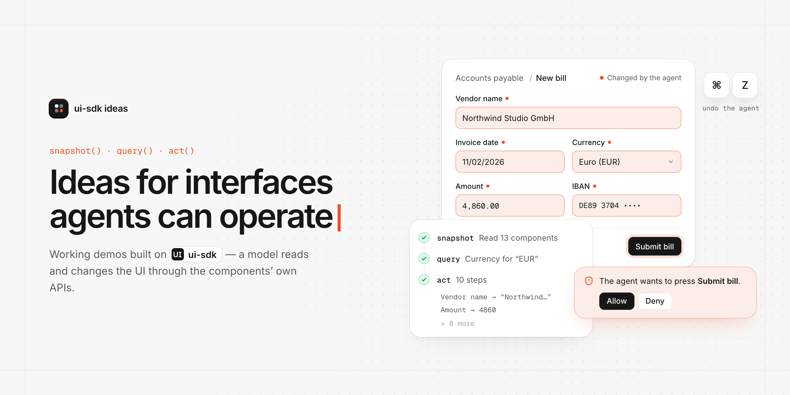
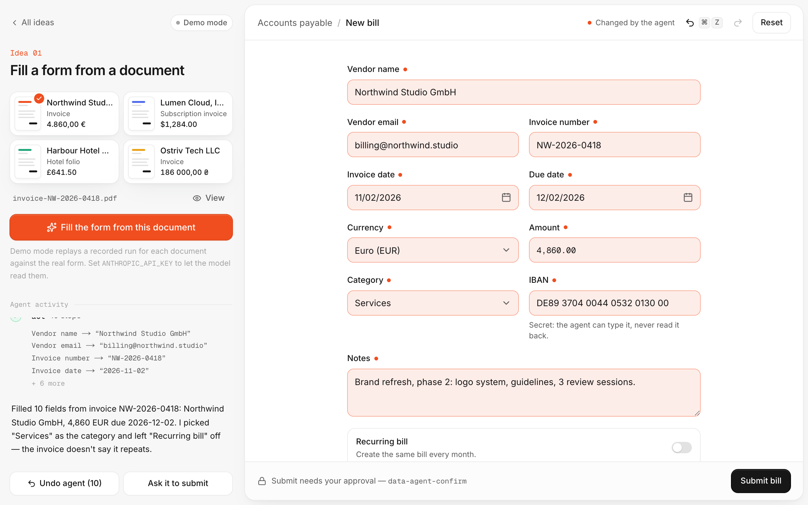
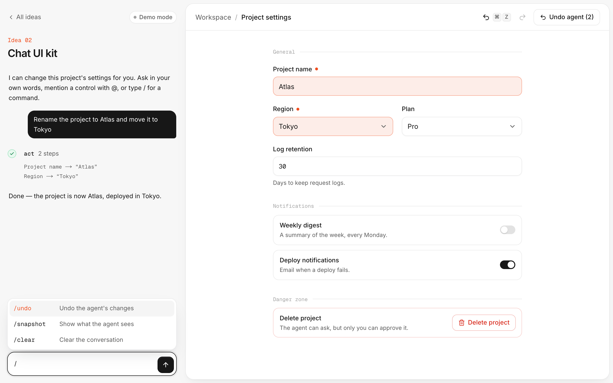

<p align="center">
  
</p>

<p align="center">
  <a href="https://github.com/kapishdima/uisdk-ideas/stargazers"></a>
  <a href="https://ui-sdk.dev/docs"></a>
  <a href="https://www.anthropic.com/claude"></a>
  <a href="https://x.com/kapish_dima"></a>
  <br />
  
  
  
  
  
</p>

# ui-sdk ideas

Working demos of interfaces an AI agent can operate, built on [ui-sdk](https://ui-sdk.dev/docs).

Every ui-sdk component on the page joins an **agent bridge**. A model reads the UI with `snapshot()`, looks up a list's choices with `query()` and changes it with `act()`. It goes through the components' own APIs, not through DOM clicks or screenshots. So the page always knows what the agent did: it highlights those changes, can undo them, and asks the person before anything that needs approval.

## Demos

### 01 · Fill a form from a document



Pick one of four sample documents and the agent fills a **New bill** form from it in one `act()` call.

- **Four documents in different shapes:** an invoice in EUR, a USD subscription paid by card (no IBAN, recurring), a hotel folio in GBP that's "due on receipt", and a hardware invoice in UAH.
- **Highlights:** every field the agent changed is tinted, and the header says "Changed by the agent".
- **Undo:** `⌘Z` steps back through everything that changed, yours or the agent's. The agent's whole run counts as one step. "Undo agent" reverts only the agent and keeps your edits. A field marked `data-agent-secret` (the IBAN) can be typed by the agent but never read back, so it isn't restored.
- **Approval:** "Submit bill" carries `data-agent-confirm`. When the agent tries to press it, the page asks you first.
- **Failures:** if a step fails, the field shows the bridge's error and the tool call says where it stopped.

### 02 · Chat UI kit



A chat kit made of ui-sdk parts, driving the settings screen next to it.

- **Composer:** `@` mentions the controls the agent can see and outlines the one you mean on the page. `/undo`, `/snapshot` and `/clear` open as a command list, like in Claude Code.
- **Tool calls** show as a chain: one link per call, with its steps, and its input and output on click.
- **Approvals:** "Delete project" needs your answer in the chat.
- **Your edits count:** in live mode, controls you changed by hand go to the model as context with your next message.

## Up next

| | Idea |
| --- | --- |
| 03 | **Semantic session replay.** Record "chose Region = Europe", not DOM diffs, and replay it with `act()`. |
| 04 | **Filters in plain words.** One sentence sets the Select, Date Picker and Slider on a dashboard. |
| 05 | **Undo only the agent.** An app-wide history where `⌘Z` reverts the agent and keeps your edits. |
| 06 | **Your site, ready for WebMCP.** One line lets the browser's own agent use your forms; the person brings the model. |

## Run it

```bash
bun install
bun dev
```

Open http://localhost:3000.

Without an API key, the demos run in **demo mode**. The recorded runs make the same real tool calls against the page; only the model's replies are scripted. To talk to a live model, create `.env.local`:

```bash
ANTHROPIC_API_KEY=sk-ant-...
# optional, defaults to claude-opus-5-5
# ANTHROPIC_MODEL=claude-haiku-5-5
```

## How it fits together

```
browser                                            server
───────                                            ──────
lib/run-agent.ts ───── conversation ───────────▶  app/api/agent/route.ts
       ▲                                           one Claude turn with agentTools
       └──── tool_use: snapshot · query · act ◀──
       │
       ▼
lib/agent.ts          createAgent({ allow })  ──▶  ui-sdk components on the page
                                                   data-agent-confirm → asks the person
lib/use-agent-page.ts createHistory           ──▶  highlights · ⌘Z / ⌘⇧Z · undoSource("agent")
```

- `lib/agent.ts` holds the single `createAgent()` bridge. Its `allow` callback sends steps marked `data-agent-confirm` to the page's approval UI.
- `app/api/agent/route.ts` handles one model turn and passes `agentTools` to Claude. The API key stays on the server.
- `lib/run-agent.ts` runs the loop in the browser: it posts the conversation, runs the returned tool calls on the page through the bridge, and repeats.
- `lib/use-agent-page.ts` scopes `createHistory` to a region. That powers undo and redo, "Undo agent", and the highlights on the controls the agent changed.
- `components/chat-kit/` is the chat kit: thread, tool-call chain, approval card and composer.
- `components/ui/fields.tsx` has styled wrappers over ui-sdk components, shadcn-style.
- `components/demo-shell.tsx` is the layout both demos share: the agent's column on the left, the app on a white sheet.
- `components/showcase/previews.tsx` draws the small previews on the showcase cards.
